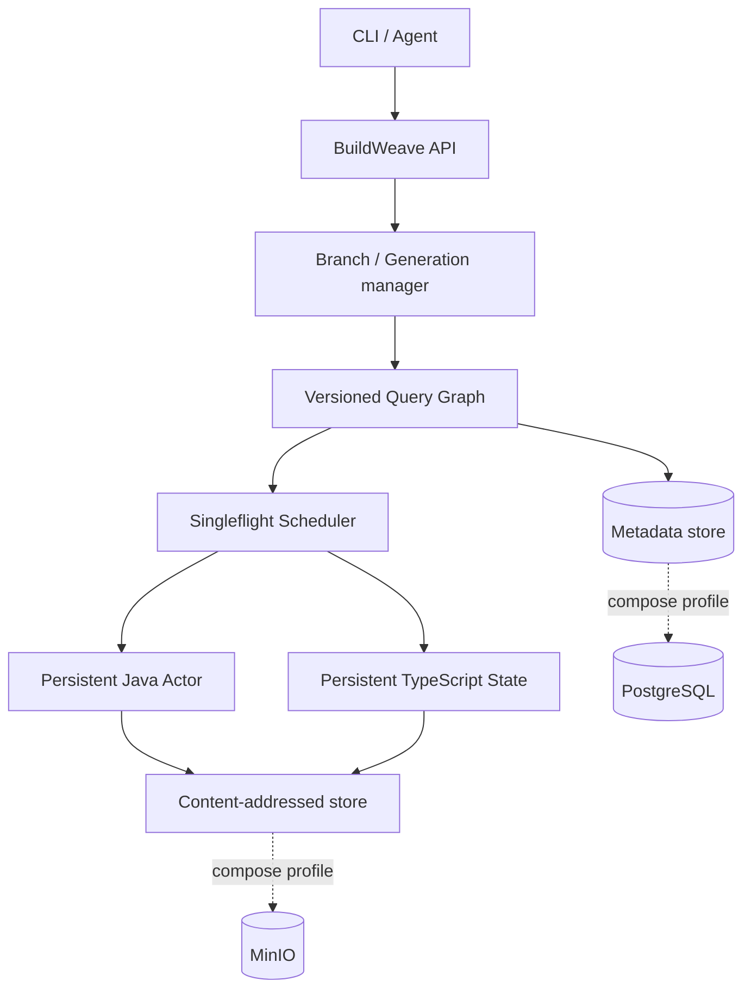

# BuildWeave

> A persistent, revision-aware build fabric that preserves valid computation across code changes.

BuildWeave is a local, runnable prototype of a living build system. A commit is provenance, not a universal cache key: computations are identified by their exact source inputs, semantic dependencies, toolchain, and environment.

## The hypothesis

```text
verified_state(N+1) = update(verified_state(N), delta)
```

instead of `commit -> new worker -> rebuild universe`.

## Quick start

Prerequisites: Go 1.24+, a JDK with `javac`/`javap`, and optionally Docker.

```bash
docker compose up -d   # PostgreSQL + MinIO profile (optional for local demo)
make bootstrap
make demo
```

`make demo` uses the file-backed adapters, real Java class files, and recorded query values. Run `make help` for all targets.

## What the prototype demonstrates

- **Phase 1 — warm repository actor:** persistent workspaces and actor output directories, repeat verification reuse, CAS population, timings, and clean shadow compilation with output-digest comparison.
- **Phase 2 — semantic invalidation:** public Java ABI values derived from compiled classes with `javap`; reverse dependencies; downstream compilation cutoff when bytecode changes but ABI does not; shared in-flight work and nondeterminism detection.
- **Phase 3 — TypeScript and agent protocol:** declaration-equivalent export signatures, typecheck cutoff, immutable `OpenBranch`/`ApplyDelta` generations, `Verify`, exact-tree `Seal`, and reuse after a commit SHA appears.



The executable defaults to durable local adapters so tests need no network services. Compose brings up PostgreSQL and MinIO, initializes the metadata schema and CAS bucket, and demonstrates the production-shaped boundary.

## CLI

```bash
bin/buildweave branch open --source demo
bin/buildweave branch apply --branch BRANCH --expected 0 --changes changes.json
bin/buildweave verify --branch BRANCH --generation 1 --profile agent-fast
bin/buildweave explain --branch BRANCH --generation 1
bin/buildweave graph --branch BRANCH --generation 1
bin/buildweave seal --branch BRANCH --generation 1 --commit abc123 --tree sha256:...
bin/buildweave status
bin/buildweave cas stats
```

Changes are a JSON array such as `[{"path":"java/core/src/main/java/...","content":"..."}]`. Apply rejects stale generations. Seal rejects a digest other than the immutable generation tree.

## Correctness boundaries

Persistent mutable state is only an optimization. Every reusable value has a deterministic fingerprint and a stored explanation. Java ABI equality permits cutoff only for downstream **compilation**; tests remain runtime-dependent. TypeScript declaration equality permits cutoff only for downstream **typechecking**; it does not prove runtime, tests, or bundling unchanged. When no explicit semantic boundary exists, BuildWeave recomputes.

## Limitations

This is an educational single-process prototype, not a production CI replacement. The runnable profile uses atomic JSON metadata and a filesystem CAS; PostgreSQL schema and MinIO Compose services show the deployment model. The TypeScript signature extractor supports the demo's exported declarations rather than the full compiler type system. The portable Java wrapper uses the installed JDK if Gradle is unavailable. Authentication, distributed execution, signing/evidence, and Phase 4+ are intentionally absent.

See [architecture](docs/architecture.md), [demo guide](docs/demo.md), [phases](docs/phases.md), and the [Tekton task](tekton/task.yaml).

Licensed under Apache-2.0.
