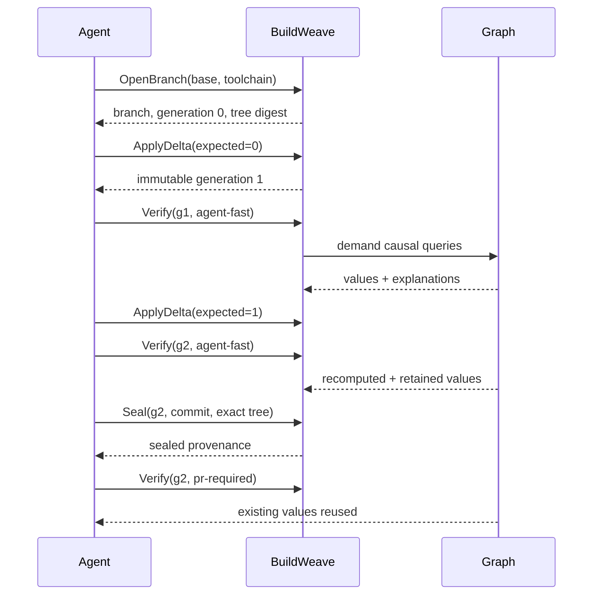

# Architecture

BuildWeave separates immutable provenance from computation identity. `BranchSession` is a mutable pointer to the latest generation; each `RevisionGeneration` is immutable and contains a deterministic source-tree digest. `QueryDefinition` names logical work. `QueryValue` records the computation fingerprint, byte output, explicit semantic value, dependencies, and originating generation. Subscriber sets belong to executing fingerprints rather than pipeline runs.

## Identity

```text
fingerprint = SHA256(
  query definition
  + sorted exact input digests
  + sorted semantic dependency digests
  + toolchain identity
  + relevant environment
)
```

Commit SHA is deliberately absent. It is stored on `RevisionGeneration` by `Seal` as provenance. The filesystem CAS uses `sha256:<hex>` addresses. Metadata is atomically durable in the zero-service profile; `internal/metadata/schema.sql` maps the same domain to PostgreSQL. Compose initializes PostgreSQL and MinIO.

## Execution and cutoff

The repository actor retains workspaces and compiler output directories. An exact fingerprint hit is `REUSED`. A source change recomputes the module. Java class output has a byte digest and a public ABI semantic digest derived from `javap -public -s`. Equal ABI stops compile-dependency propagation (`RETAINED`), while runtime test fingerprints still contain implementation digests. TypeScript uses the same boundary with export signatures and downstream typechecks.

The scheduler keys in-flight work by computation fingerprint. Generations subscribe to the call. Removing one subscriber does not cancel work needed by another. Independent conflicting outputs for one fingerprint produce `NONDETERMINISTIC`.



Persistent state is never authoritative: the clean shadow compiler rebuilds Java outputs in a new directory and compares actual digests.
